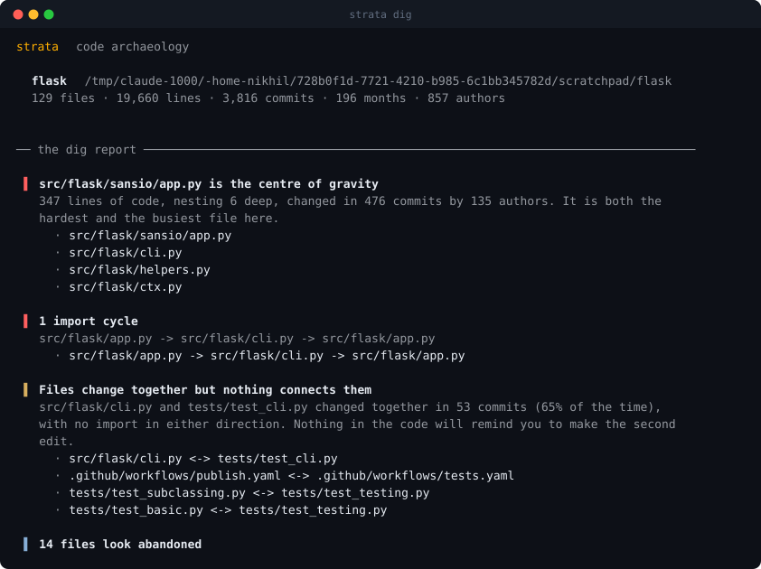
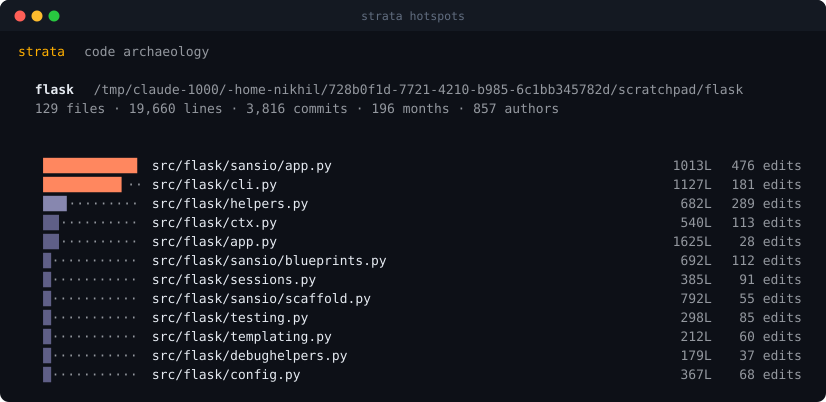
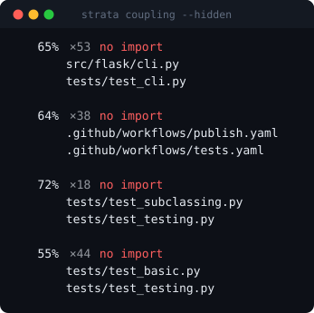
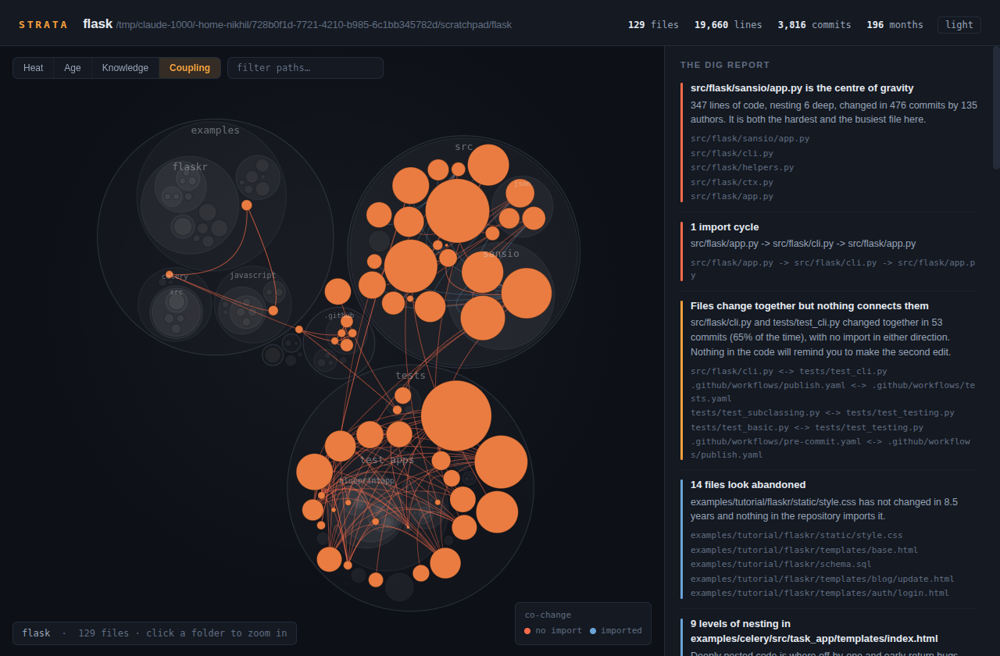
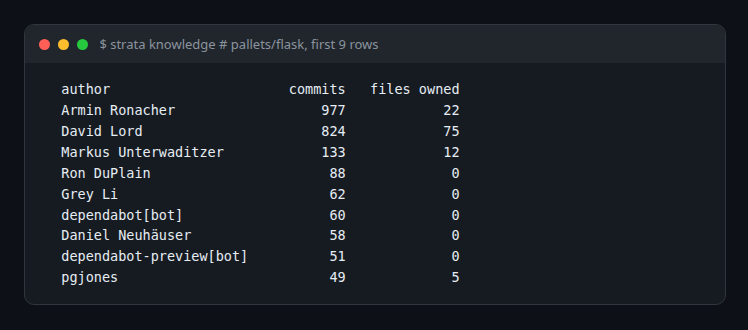

# strata

<p align="center">
  
  
  
  
</p>

**Your repository already knows which files are dangerous. It has been writing
it down in the git log for years.** `strata` reads that, crosses it with the
shape of the code, and hands you one self-contained HTML file.

```bash
strata dig                  # → strata-report.html
```


That is Flask: 129 files, 3,816 commits, 16 years, 857 authors — analysed in
under two seconds, from a cold start, with nothing installed but Python.

## Why

Every tool that measures a codebase measures it as it is *right now*. That is
half the story, and it is the less useful half.

A thousand-line file nobody has opened since 2019 is not a problem. A
two-hundred-line file that four people rewrote last month is. Complexity only
becomes risk when it is multiplied by change — and change is the axis that
static analysis cannot see.

`strata` reads both:

| Question | Where the answer comes from |
| --- | --- |
| Which file will bite me? | nesting depth × recency-weighted commit count |
| What breaks when I edit this? | files that co-change in git, with **no import between them** |
| What is safe to delete? | idle for a year, imported by nothing |
| What happens if one person leaves? | files with exactly one author, ever |
| Where is the knot? | import cycles, found with Tarjan's algorithm |

The middle one is the reason this tool exists. Import graphs show you coupling
somebody wrote down. Git shows you coupling nobody did.

## Install

```bash
pipx install git+https://github.com/nikhilcherry/strata.git
```

Or don't install it at all — it has no dependencies, so a clone runs directly:

```bash
git clone https://github.com/nikhilcherry/strata.git
cd strata && python3 -m strata dig ~/code/your-project
```

## What it tells you

```bash
strata dig ~/code/flask
```



Then the ranked list, which is the part you will actually use day to day:



Heat is `complexity × change`, where a commit from last week counts for twice
one from six months ago. Both terms matter: `src/flask/app.py` is the *longest*
file in Flask at 1,625 lines and it is not the hottest, because almost nobody
edits it any more.

### The finding that has no other source



`src/flask/cli.py` and `tests/test_cli.py` changed together 53 times. Nothing
in either file mentions the other. Every tool that reads only source code is
blind to this, and it is exactly the pair where somebody forgets the second
edit.

In the report, switch to **Coupling** and the arcs draw themselves — red where
there is no import to explain them:



## The four views

| View | Colour means |
| --- | --- |
| **Heat** | complexity × recent change — where the risk is |
| **Age** | how recently the file was touched — where the frontier is |
| **Knowledge** | who owns it — where the bus factor is |
| **Coupling** | which files move together — where the surprises are |

Circles are files, sized by line count, nested inside their directories. Click a
folder to zoom in, click a file for its full record, type in the box to filter,
press <kbd>Esc</kbd> to reset.

## Who knows what

`strata knowledge` counts commits per author and which files each person effectively owns, then lists the files only one person has ever touched. On Flask, 800-odd commits from one maintainer and a long tail of authors who own nothing is exactly the kind of fact a hiring manager or a new tech lead wants before touching a module.



## Commands

```
strata dig [PATH]          full analysis: terminal summary + HTML report
strata hotspots [PATH]     the ranked list, nothing else
strata coupling [PATH]     files that change together   (--hidden for the good ones)
strata fossils [PATH]      idle code that nothing imports
strata cycles [PATH]       import cycles
strata knowledge [PATH]    who owns what, and what only one person knows
```

Useful flags:

```
-o FILE                 where to write the report  (default: strata-report.html)
--open                  open it when it is written
--json FILE             machine-readable output, for CI
--since '2 years ago'   ignore ancient history
--half-life DAYS        how fast a change stops counting (default: 180)
--exclude FRAGMENT      skip paths containing FRAGMENT  (repeatable)
--no-history            rank on structure alone
```

`strata` on its own means `strata dig .`.

## How it works

Four passes, one git invocation, no index and no cache.

1. **Discovery.** Inside a repository, `git ls-files` supplies the file list —
   which means `.gitignore` is honoured exactly, not approximately. Outside one,
   a conservative walk with a deny-list.

2. **Shape.** Complexity is measured as *total indentation across logical
   lines*. Counting branches properly needs a parser per language, and a parser
   per language is a project that never ends; nesting is what makes code hard to
   hold in your head, and every language in common use indents its nesting. Tabs
   and 2- or 4-space files measure identically — the indent unit is inferred per
   file.

3. **Structure.** Imports are extracted per language and *resolved against files
   that actually exist*, so a wrong edge would have to survive a filesystem
   check. Anything unresolved is recorded as an external dependency. 25
   languages, including Python, TypeScript, Go, Rust, Java, Kotlin, C/C++, C#,
   Dart, Ruby, PHP and Swift.

4. **Time.** One `git log --numstat` pass yields per-file commit counts, churn,
   authorship and dates. Renames are followed, so a file that moved last year
   keeps the history it earned under its old name.

The map is laid out in Python — front-chain circle packing with Welzl's
smallest-enclosing-circle — so the geometry is deterministic and tested, and the
page has no layout pass and no charting library. The report is one file with the
data baked in: no server, no CDN, no network. It opens on a plane.

## Honest limits

- **Indentation is a proxy for complexity, not a measurement of it.** A flat
  file of a thousand terrible one-liners scores low. In practice the proxy
  correlates well enough to rank files, which is all the ranking needs.
- **Import resolution is regex-based.** It resolves what it can prove and calls
  everything else external. Dynamic imports, reflection and DI containers are
  invisible to it — which is part of why the git-based coupling matters.
- **Squash-merge repositories lose coupling signal.** If every pull request
  lands as one commit, co-change says "everything in that PR", and `strata`
  discards commits touching more than 40 files to limit the damage.
- **Authorship is `git log` authorship.** Pair programming, rewrites and bulk
  reformatting all lie to it.
- **A young repository has little to say.** Below roughly fifty commits, trust
  the structural findings and ignore the temporal ones.
- **Partial clones are slow.** `git log --numstat` on a `--filter=blob:none`
  clone refetches blobs one at a time. Use a full clone.

## Tests

```bash
python3 -m unittest discover -s tests -v
```

39 tests, no dependencies. The history tests build real git repositories in a
temporary directory and run real git against them, because the thing most likely
to break is our reading of git's output — and a mock of git would only ever tell
us what we already believe. The packing tests assert that no two sibling circles
overlap and no child escapes its parent, which is the difference between a map
and a decoration.

Every image in this README is a real run:

```bash
scripts/make_docs_images.sh ~/code/flask
```

## License

MIT.
