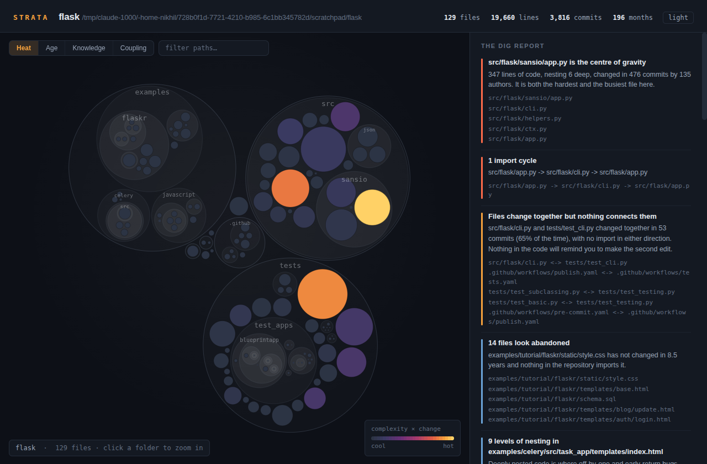

<div align="center">

# strata
### Your repository already knows which files are dangerous. It has been writing it down in the git log for years.

    



<sub>Flask: 129 files, 3,816 commits, 16 years, 857 authors. Analysed in under two seconds from a cold start, with nothing installed but Python.</sub>

</div>

`strata` reads git history, crosses it with the shape of the code, and hands you **one self-contained HTML file**: no server, no CDN, no network. It opens on a plane.

```bash
pipx install git+https://github.com/nikhilcherry/strata.git
strata dig ~/code/your-project        # → strata-report.html

# or with nothing installed at all:
git clone https://github.com/nikhilcherry/strata.git && cd strata && python3 -m strata dig ~/code/your-project
```

## 40-second demo

<p align="center"><a href="docs/media/demo.mp4"></a><br><sub>▶ Click for the full 40-second video with sound. Every image in it is a real screenshot or run from this repo.</sub></p>

## What it answers

Every tool that measures a codebase measures it as it is *right now*. A thousand-line file nobody has opened since 2019 is not a problem. A two-hundred-line file four people rewrote last month is. Complexity becomes risk only when multiplied by change, and change is the axis static analysis cannot see.

| Question | Where the answer comes from |
| --- | --- |
| Which file will bite me? | nesting depth × recency-weighted commit count |
| What breaks when I edit this? | files that co-change in git, with **no import between them** |
| What is safe to delete? | idle for a year, imported by nothing |
| What happens if one person leaves? | files with exactly one author, ever |
| Where is the knot? | import cycles, found with Tarjan's algorithm |


Then the ranked list, the part you will use day to day. Heat is `complexity × change`, where a commit from last week counts twice one from six months ago. `src/flask/app.py` is the *longest* file in Flask at 1,625 lines and not the hottest, because almost nobody edits it any more.


## The finding that has no other source

Import graphs show you coupling somebody wrote down. Git shows you coupling nobody did. `src/flask/cli.py` and `tests/test_cli.py` changed together **53 times** and nothing in either file mentions the other. That is exactly the pair where somebody forgets the second edit.

| Terminal | The same finding in the report's Coupling view |
|---|---|
|  |  |

## Who knows what

`strata knowledge` counts commits per author and which files each person effectively owns, and lists the files only one person has ever touched. On Flask, two maintainers account for most of the history (977 and 824 commits) while most other authors own no files. That is what a new tech lead wants to know before touching a module.


## Decisions worth knowing

- **Indentation as the complexity measure.** Counting branches properly needs a parser per language, and that is a project that never ends. Nesting is what makes code hard to hold in your head, and every common language indents it. The indent unit is inferred per file, so tabs and 2- or 4-space files score alike.
- **Imports are resolved against files that exist.** A wrong edge would have to survive a filesystem check; anything unresolved is recorded as external.
- **One git invocation, no index, no cache.** A single `git log --numstat` pass gives commits, churn, authorship and dates, and renames are followed.
- **The layout is computed in Python**, not in the browser: front-chain circle packing with Welzl's smallest enclosing circle. The geometry is deterministic and tested, and the page needs no layout pass and no charting library.
- **Tests run real git.** The history tests build real repositories in a temp directory, because the thing most likely to break is our reading of git's output, and a mock only tells us what we already believe. Packing tests assert that no sibling circles overlap and no child escapes its parent. 39 tests, no dependencies.

## Honest limits

- **Indentation is a proxy for complexity, not a measurement of it.** A flat file of a thousand terrible one-liners scores low. It correlates well enough to rank files, which is all the ranking needs.
- **Import resolution is regex-based**: dynamic imports, reflection and DI containers are invisible to it, which is part of why git-based coupling matters.
- **Squash-merge repositories lose coupling signal.** Commits touching more than 40 files are discarded to limit the damage.
- **Authorship is `git log` authorship**: pair programming, rewrites and bulk reformatting all lie to it.
- **A young repository has little to say.** Below roughly fifty commits, trust the structural findings and ignore the temporal ones.
- **Use a full clone.** `git log --numstat` on a partial clone refetches blobs one at a time.

<details>
<summary>The four views of the report</summary>

| View | Colour means |
| --- | --- |
| **Heat** | complexity × recent change: where the risk is |
| **Age** | how recently the file was touched: where the frontier is |
| **Knowledge** | who owns it: where the bus factor is |
| **Coupling** | which files move together: where the surprises are |

Circles are files, sized by line count, nested inside their directories. Click a folder to zoom in, a file for its full record, type to filter, <kbd>Esc</kbd> to reset.

</details>

<details>
<summary>Commands and flags</summary>

```
strata dig [PATH]          full analysis: terminal summary + HTML report
strata hotspots [PATH]     the ranked list, nothing else
strata coupling [PATH]     files that change together   (--hidden for the good ones)
strata fossils [PATH]      idle code that nothing imports
strata cycles [PATH]       import cycles
strata knowledge [PATH]    who owns what, and what only one person knows
```

Useful flags:

```
-o FILE                 where to write the report  (default: strata-report.html)
--open                  open it when it is written
--json FILE             machine-readable output, for CI
--since '2 years ago'   ignore ancient history
--half-life DAYS        how fast a change stops counting (default: 180)
--exclude FRAGMENT      skip paths containing FRAGMENT  (repeatable)
--no-history            rank on structure alone
```

`strata` on its own means `strata dig .`.

</details>

<details>
<summary>How it works, in four passes</summary>

Four passes, one git invocation, no index and no cache.

1. **Discovery.** Inside a repository, `git ls-files` supplies the file list —
   which means `.gitignore` is honoured exactly, not approximately. Outside one,
   a conservative walk with a deny-list.

2. **Shape.** Complexity is measured as *total indentation across logical
   lines*. Counting branches properly needs a parser per language, and a parser
   per language is a project that never ends; nesting is what makes code hard to
   hold in your head, and every language in common use indents its nesting. Tabs
   and 2- or 4-space files measure identically — the indent unit is inferred per
   file.

3. **Structure.** Imports are extracted per language and *resolved against files
   that actually exist*, so a wrong edge would have to survive a filesystem
   check. Anything unresolved is recorded as an external dependency. 25
   languages, including Python, TypeScript, Go, Rust, Java, Kotlin, C/C++, C#,
   Dart, Ruby, PHP and Swift.

4. **Time.** One `git log --numstat` pass yields per-file commit counts, churn,
   authorship and dates. Renames are followed, so a file that moved last year
   keeps the history it earned under its old name.

The map is laid out in Python — front-chain circle packing with Welzl's
smallest-enclosing-circle — so the geometry is deterministic and tested, and the
page has no layout pass and no charting library. The report is one file with the
data baked in: no server, no CDN, no network. It opens on a plane.

</details>

Every image here is a real run: `scripts/make_docs_images.sh ~/code/flask`. Tests: `python3 -m unittest discover -s tests -v`. MIT.
